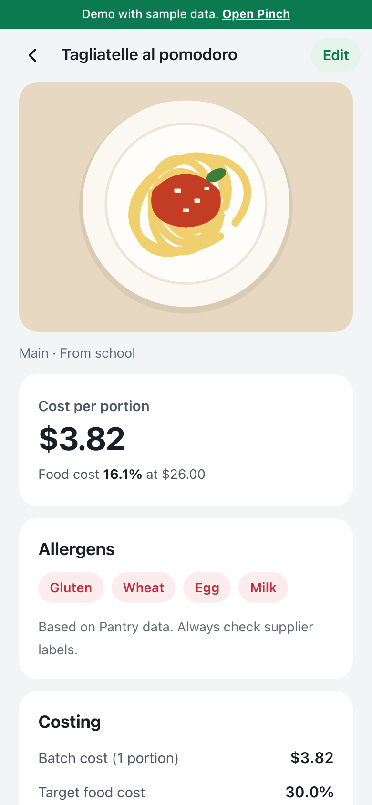
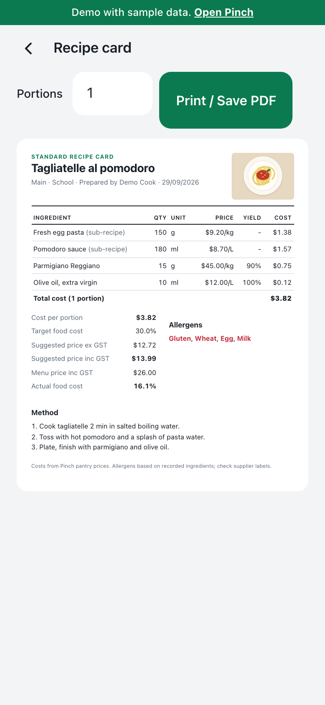
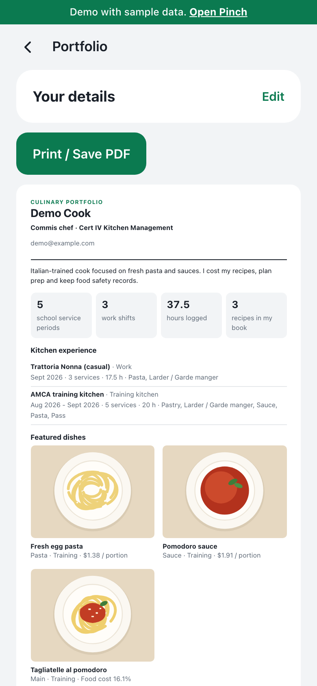

# Pinch

**A study companion for culinary students**: your class recipes, practice, exams, flash cards and class log in one installable app that works offline.

**[Open the app](https://jblee3030.github.io/pinch/)** · **[Try the demo with sample data](https://jblee3030.github.io/pinch/?demo)**

<table>
  <tr>
    <td></td>
    <td></td>
    <td></td>
  </tr>
  <tr>
    <td align="center">Recipe, costing &amp; allergens</td>
    <td align="center">Costed recipe card (PDF)</td>
    <td align="center">Portfolio (PDF)</td>
  </tr>
</table>

## Why

I built Pinch while studying Commercial Cookery and Kitchen Management (Cert IV) in Melbourne. Class recipes arrive as handouts and whiteboards, practice notes end up in a phone's camera roll, and the service-period logbook is on paper. Pinch keeps the whole course in one place: write or snap a recipe, practise it and rate each attempt, see which exam dishes still need work, revise the theory with flash cards, and log every service toward the course requirement. It follows Australian kitchen practice: AU cup and spoon measures, FSANZ allergens and food safety limits, GST-inclusive prices.

## Features

**Recipes**
- Recipe book with photos, method, sub-recipes (a sauce or dough inside a dish), favourites on Home and search by ingredient
- Amounts are optional: oil, salt or anything "to taste" is saved as q.b. (quanto basta), shown as q.b. everywhere and left out of costing
- Get recipes in fast: quick capture (name + ingredient lines), read a photo of a handout, book page, handwritten note or whiteboard (Claude via a Supabase Edge Function; signed-in users, daily limit), import a recipe web page, or paste a list (fractions, ranges, AU cup / tbsp / tsp)
- Instagram captions: "01. Dish name" (each recipe keeps its post number, new ones get the next) and the recipe in short, ingredients and method, ready to copy ([`caption.js`](caption.js))
- Share a recipe with classmates as a link: the recipe, its sub-recipes and ingredients travel inside the link (compressed, no server or account) and save into their own book
- Scale by portions, from an ingredient you have ("3 kg mince makes 37 portions") or by baker's percentage
- Cooking mode: every step on one screen, the current one big and outlined, done ones ticked; Next moves on and scrolls to it, tap any step to jump; timers found in the method ("simmer 45 min"), a scaled ingredient checklist, screen kept awake
- Costing for assignments: ingredient prices (optional), trim yield and yield tests, cost per portion, suggested price from a target food cost %, actual food cost % (GST-aware); missing prices are flagged, never counted as $0
- Costed standard recipe card, printable to A4 / PDF; allergen chart across all recipes (Australian mandatory allergens)
- Kitchen calculator (cups and spoons to grams per ingredient, °F/°C with fan-forced, oz/lb/fl oz) and kitchen timers that keep running across screens

**Practice and exams**
- Practice log per recipe: rating, photo, how it went and what to change next time; the last note shows when you start cooking, and finishing cooking mode asks how it went
- Exam and assessment planner: date, type and the dishes being assessed; each dish shows how often it's been practised and its last rating
- Work flow plan for practicals: paste all the day's recipes (or add them from the book) and Pinch lays out the work plan, time by time with equipment (long jobs like simmering or setting start first, other work fits around them, plating waits for setup after lunch), and the combined ingredients list with totals per recipe. Both copy as tables; optionally it fills the school's Work Flow Plan Word form. Rules only, no AI ([`workflow.js`](workflow.js), [`docx.js`](docx.js))
- Prep list for a practical: recipes and portions become ordered task cards (sub-recipes first, longest jobs first) with weigh-out and method checklists and step timers
- Menus with menu engineering (Kasavana & Smith) and a printable customer allergen menu, for menu design assignments

**Study**
- Flash card decks: knife cuts, food safety temperatures (FSANZ), steak doneness, mother sauces, ratios and kitchen terms; spaced repetition (1, 3, 7, 14, 30 days)
- Drawn diagrams on the cards: knife cuts to scale on a ruler, steak cross-sections with core temperatures, food safety temperatures on one thermometer (danger zone, 2-stage cooling, the 2-hour / 4-hour rule), what goes into each sauce, and ratio bars. Pure SVG in [`cardart.js`](cardart.js): no images to download, works offline
- My cards: make your own cards from class (question, answer, optional photo), grouped into your own decks, on the same review schedule
- Home: what needs doing today (the next exam and dishes to practise, cards due, prep progress, today's service to log) and every tool in one grid

**Class log and portfolio**
- Class log: log today's class service in two taps (kitchen, station and hours carried over), with progress toward the course's required service periods
- Tick what you cooked from your recipe book (recently cooked first, search for big books) and rate each dish: every ticked dish also becomes a practice cook of that recipe with the chef's feedback, so recipe practice, cooking-mode notes and exam readiness all count class services
- Food safety temperature log and opening, closing and cleaning checklists for kitchen practicals and placements
- Portfolio page generated from the log and featured dishes, printable to PDF

**Data**
- English or Korean, switched in Settings. Recipe cards, the portfolio and study cards stay in English for school and work
- Works offline; data lives on the device. Optional account: email + password sign-in syncs phone and laptop
- JSON backup export / import

## Design

Mobile-first and Toss-inspired: grey canvas, flat white cards, the key number biggest, one primary action per screen, 44 px touch targets, WCAG AA contrast. Tokens, components and rules: [`DESIGN.md`](DESIGN.md).

## How it's built

| | |
|---|---|
| **Frontend** | Vanilla JavaScript (ES modules), HTML and CSS — no framework, no build step, no runtime dependencies. ~1,300 lines of app code. |
| **App shell** | Installable PWA with a network-first service worker: always fresh online, fully usable offline. |
| **Storage** | IndexedDB is the source of truth (local-first). Schema upgrades only add stores, so existing data is never touched. |
| **Sync** | Supabase (Postgres) through its REST API. One `items` table protected by row-level security. Each device pushes changed rows and pulls rows past its own cursor; deletes are tombstones; conflicts resolve last-edit-wins on both client and server (a Postgres trigger rejects older writes). Schema: [`supabase.sql`](supabase.sql). |
| **Costing engine** | Pure functions in [`calc.js`](calc.js): unit conversion, recursive sub-recipe costing with cycle detection, scaling, prep batches, menu engineering, food safety rules. |
| **Parsing** | [`parse.js`](parse.js): ingredient-line parser (fractions, ranges, `2 x 400g`, AU measures), word-based matching to saved ingredients, method steps and timers. |
| **Recipe import** | Supabase Edge Function [`recipe-import`](supabase/functions/recipe-import/index.js) reads the page's schema.org Recipe (JSON-LD) and returns only the recipe; public http(s) pages only, size and time limits. |
| **Tests** | `node calc.test.js` — assertion-based checks for costing, sub-recipes, circular references, temperature limits, sync conflict rules, recipe parsing and import, sharing, and the Korean UI. |
| **Recipe photos** | Supabase Edge Function [`recipe-photo`](supabase/functions/recipe-photo/index.js) sends the photo to Claude (Anthropic API) and returns the English and Italian names, servings, ingredient lines and steps as structured JSON; signed-in users only, 30 a day each, photos not stored. |
| **Hosting** | GitHub Pages; every push to `main` deploys. index.html loads every file with one `?v=` release number (an import map for the modules), so the CDN can never serve a mix of old and new files. |

```
index.html   app shell and tab bar
app.js       screens and routing
calc.js      costing, scaling and food safety rules (pure, tested)
study.js     reference decks and spaced repetition (pure, tested)
cardart.js   drawn SVG diagrams for the study cards
parse.js     pasted recipes, method steps and timers (pure, tested)
workflow.js  practical day plan: recipes, time plan, ingredients list (pure, tested)
docx.js      fills the Work Flow Plan Word form (zip + WordprocessingML, no library)
db.js        IndexedDB storage, change tracking, backup
sync.js      optional Supabase auth and sync
sw.js        offline support
```

## Run locally

No install needed.

```
python3 -m http.server 8000     # then open http://localhost:8000
node calc.test.js
```

Add `?demo` to the URL to open a separate database filled with sample data.

## Roadmap

- Custom email delivery (SMTP) so reset emails reach every user
- Sharing with classmates and a teacher view of service logs
- App Store / Play Store packaging
